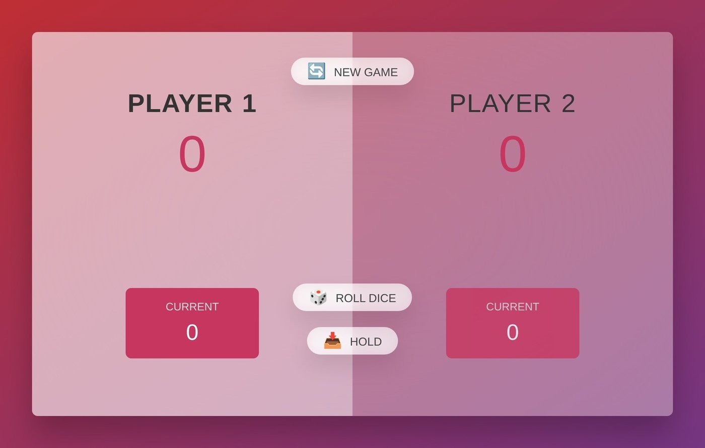
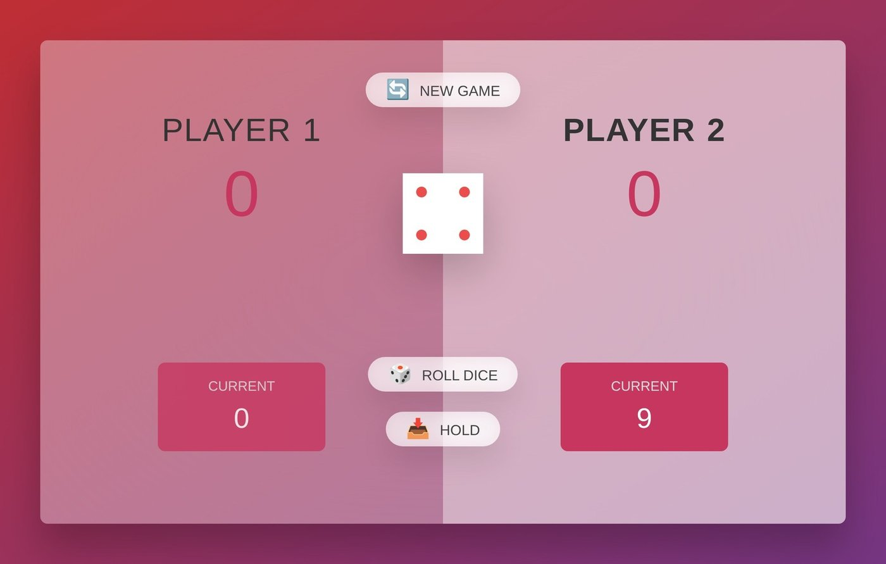
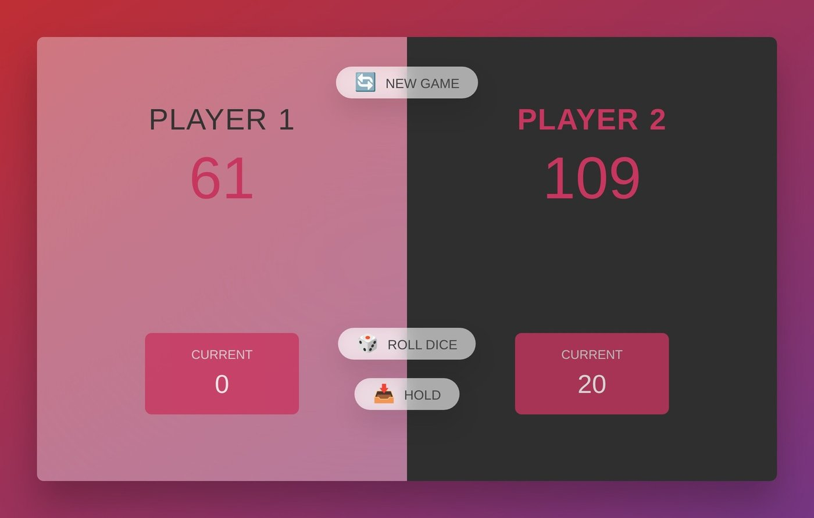

# Pig Game

A two-player dice game: roll to build up points, hold to bank them.

> Built while following a JavaScript course, so it shows what I learned rather than an original design.

## Rules

- On your turn, roll the die and add it to your current score
- Rolling a **1** loses the current score and passes the turn
- **Hold** adds the current score to your total and passes the turn
- The first player to reach **100** wins

## Tech

JavaScript, HTML, CSS. No dependencies.

## Run

Open `final/index.html` in a browser.

## Author

Harun Kestendžić — [GitHub](https://github.com/harunkestendzic)
